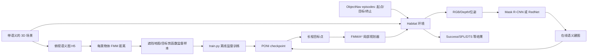

# PONI 工程总览与阅读路线

本文对应当前工作树（2026-09-18）。四个阶段分别见 [Gibson 训练](gibson-train.md)、[Gibson 验证/评测](gibson-val.md)、[MP3D 训练](mp3d-train.md)、[MP3D 验证/评测](mp3d-val.md)。`train` 指离线训练 PONI 势函数网络；`val` 同时包含离线验证集和在线 ObjectNav 评测，二者不是同一批数据，也不是同一个指标。

## 先建立一个准确的心智模型



- **3D 场景**是模拟器渲染和碰撞的世界；**俯视语义图**是从场景离线提取、用于监督训练的二维标签，不是模拟器的 episode。
- **episode** 是一次任务：起点、朝向、目标类别及相关导航信息；它只在在线评测时决定“从哪出发、找什么”，并不提供神经网络训练样本。离线训练的采样入口是 [SemanticMapDataset.__getitem__](../poni/dataset.py#L124)。
- **checkpoint** 只对应“在未探索区域哪里值得看”的模型。运行时还要语义分割、在线建图、局部规划器与 Habitat；checkpoint 本身不能直接吃 RGB 输出动作。
- **Gibson 在线评测**走 [semexp/eval_poni.py](../semexp/eval_poni.py#L28)，评测时手动从 PONI Box 包载入 episode，并用语义 GT 地图算成功距离。
- **MP3D 在线评测**走 [hlab/eval_poni.py](../hlab/eval_poni.py#L14) 和 Habitat-Lab 的 ObjectNav dataset/metrics；代码路径、成功定义、分割网络和输出格式都不同。不能直接横向比较两者绝对数值。

## graph.db 怎么用

[graph.db](../.code-review-graph/graph.db) 是 SQLite 静态代码图，`nodes` 记文件/类/函数，`edges` 记 `CALLS`、`IMPORTS_FROM` 等，`flows`/`flow_memberships` 记关键路径。当前库的 `metadata.git_head_sha=30682c2...`，节点有 433 个函数、59 个类，`flows` 中最关键的是 `hlab/eval_poni.py:main` (id 1)、`semexp/eval_poni.py:main` (id 2)、`poni/dataset.py:__getitem__` (id 5)、`scripts/create_poni_dataset.py:precompute_dataset` (id 8)、`scripts/precompute_fmm_dists.py:precompute_fmm_dists` (id 9)、`train.py:main` (id 24)。可读查询：

```bash
cd /mnt/jfzn/shensj/PONI
sqlite3 -header -column .code-review-graph/graph.db \
  'SELECT f.id,f.name,n.file_path,n.line_start FROM flows f JOIN nodes n ON n.id=f.entry_point_id ORDER BY f.criticality DESC LIMIT 25;'
sqlite3 -header -column .code-review-graph/graph.db \
  "SELECT kind,source_qualified,target_qualified FROM edges WHERE file_path LIKE '%semexp/eval_poni.py' AND kind='CALLS' LIMIT 40;"
```

它是**代码索引，不是运行轨迹**：配置字符串、Habitat registry、模型动态选择、跨进程调用、shell 启动链和工作树中的补丁可能不会被静态调用边完整表示。以下文档均按实际源码和磁盘内容核对；运行前以 `git diff` 和本机路径再次确认。

## 共用离线训练主干

1. [create_semantic_maps.py](../scripts/create_semantic_maps.py#L1) 读取 GLB/语义 PLY 与场景边界，生成 `point_clouds/*.h5`、`scene_boundaries/*.json`、`semantic_maps/*.h5` 和 `semmap_GT_info.json`。它先用 [SPLIT_SCENES](../poni/constants.py#L5) 限定 train+val 场景，再按楼层投影 5 cm 网格。MP3D 额外要求 `mp3d_uncompressed`，见各训练文档。
2. [precompute_fmm_dists.py](../scripts/precompute_fmm_dists.py#L25) 令 [SemanticMapDataset](../poni/dataset.py#L51) 对每楼层、每语义通道算 FMM 到目标类别的距离，写 `fmm_dists_123/<scene>_<floor>.pbz2`。`123` 是生成数据的固定随机种子标签。
3. [create_poni_dataset.py](../scripts/create_poni_dataset.py#L69) 针对每楼层随机抽样，默认总预算 train=400000、val=1000，实际每张图采 `floor(预算/地图数)+1` 条，故总数可能略多。每条 `.pbz2` 储存 `in_semmap`、完整 `semmap`、`fmm_dists`（乘 100 转 int）、场景名、世界坐标、朝向。
4. [SemanticMapPrecomputedDataset.__getitem__](../poni/dataset.py#L575) 把距离转回米，计算物体势函数 `clamp((cutoff-distance)/cutoff,0,1)`，按 frontier 制作 `loss_masks`，可选未探索面积势函数、方向、XY、动作标签；返回 `inputs['semmap']` 和 labels。
5. [train.py](../train.py#L715) → `Trainer.train` → `SemanticMapperModule.batch_step`。U-Net 编码器与物体 decoder 预测每类势函数；开启 `enable_unexp_area` 时有独立 area decoder。训练用 Adam，主目标对有效 mask 内的通道 `2:` 算 loss，area loss 相加。保存的 `.ckpt` 含 `state_dict`、optimizer、scheduler、`cfg` 等；在线加载主要取 `cfg` 和 `state_dict`。

离线样本的 5 cm、24 m 裁剪区意味着网络输入 480×480。通道 `0/1` 是 free/floor 和 wall，后面是物体类别。模型预测物体通道，但训练损失跳过前两通道。Gibson `MODEL.num_categories=17`（2 + 15），MP3D 为 23（2 + 21）；替换数据集时不能只换目录、不改通道数和类别映射。

## 模块化边界：哪里单独训练，哪里必须联调

| 模块 | 训练/替换入口 | 在线接口与必须联调的地方 |
|---|---|---|
| 俯视语义图/监督样本 | `scripts/create_semantic_maps.py`、`precompute_fmm_dists.py`、`create_poni_dataset.py`；不需要在线 episode | 5 cm 分辨率、楼层坐标、类别顺序、目标可达性决定监督标签。改它后通常要重生成样本并重训 checkpoint。|
| PONI 势函数 | `experiment_scripts/{gibson,mp3d}/train_poni.sh` → `train.py`；可以独立于 Habitat episode 训练 | [semexp/model_pf.py](../semexp/model_pf.py#L14) 从 checkpoint 还原配置/权重；`do_proc` 要喂相同顺序的 free、wall、语义通道；预测 `[B,N,H,W]` 对齐地图坐标。|
| 未探索面积头 | 同一个 `train.py`，由 `DATASET.enable_unexp_area` 开关；训练时与物体头共享 encoder，loss 相加 | 在线 `area_weight_coef` 加权到目标 PF。更改权重可仅重评测；更改监督定义或 head 要重训。|
| 分割感知 | Gibson [Mask R-CNN 入口](../semexp/envs/habitat/sem_exp.py#L646)；MP3D [RedNet](../hlab/utils/rednet_semantic_prediction.py#L401)；权重可独立训练/替换 | 输出语义通道必须与 `poni/constants.py`、`goal_cat_id`、映射器和 PONI checkpoint 的类别编号一致。分割误差会传到地图；GT segmentation 是上界/诊断，不等于论文感知设置。|
| 在线建图 | Gibson/MP3D 共用 [Semantic_Mapping](../semexp/model.py#L167)，MP3D 用 [适配器](../hlab/utils/semantic_mapping.py#L7) | RGB+Depth+相对位姿/语义概率 → 障碍、已探索、物体图；相机高度、FOV、深度单位、5 cm 分辨率需匹配。单独改建图不必重训 PONI，但会改变输入分布，应联调。|
| 长程策略 | `semexp/model_pf.py:RL_Policy.act`；MP3D [PFExp](../hlab/policies/pf_exp.py#L11) 包装它 | `get_action` 按目标类别取 PF，按 `pf_masking_opt` 遮已探索位置，返回长程目标点。可只改 `mask_size`、area 权重、`num_local_steps` 重评测，但结果不再是原配置。|
| 局部规划/控制 | Gibson `semexp/envs/habitat/sem_exp.py:_plan`；MP3D `hlab/utils/planners.py:PlannerActor` | 目标点/已发现目标语义掩码 → Gibson 用 FMM、MP3D 用 `pyastar` 加权 A* 选短期目标 → STOP/前进/转向。MP3D 的 FMM 用于另一路可达性图计算，不是当前 `_get_stg` 的规划分支；改碰撞阈值、STOP 距离、动作表会改 SR/SPL，需连同 Habitat 配置一起测。|
| 任务/指标 | Gibson episode 及手工 `get_metrics`；MP3D Habitat `ObjectNav-v1` | 任务定义/起点/目标/成功阈值/episode 数决定可比性。换 episode 后即使 checkpoint 不变，也不应与旧指标直接比较。|

**何谓“联合调优”**：仓库默认不是将分割网络、PONI 和局部规划器端到端反向传播。联合指在固定验证协议上调接口和超参，再分别训练需要变权重的模块。例如更新分割网络后先测语义类别对齐与地图质量，再测 PONI 输出与最终 SR/SPL；若修改语义类别数或训练地图分布，应重新生成监督样本、重训 PONI 并重评估。只改在线 `pf_masking_opt`/area 权重/规划器参数，通常不需要重新生成离线样本。

## 当前服务器事实与最短阅读顺序

- 环境是 `/mnt/jfzn/miniconda3/envs/poni`，不是 base。阅读顺序建议：本页 → `gibson-train.md` → `gibson-val.md` → `mp3d-train.md` → `mp3d-val.md`。
- Gibson 的 30 个场景俯视图和 Box 验证 episodes 已在；离线 `fmm_dists_123`、`precomputed_dataset_24.0_123_spath_square` 当前不存在，所以**评测已复现不等于训练数据已备齐**。
- MP3D episodes 与预训练模型已在；`data/scene_datasets/mp3d`、`mp3d_uncompressed` 和 `data/semantic_maps/mp3d` 当前不存在。先补场景才能跑在线 MP3D 评测；从头训练还需要 uncompressed 场景与离线样本。
