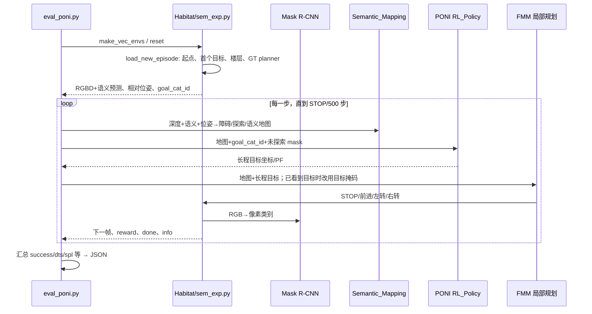

# Gibson val：离线选模与在线 ObjectNav 评测

这里有两个不同的 `val`：① 离线预计算样本的 val，只用于 [train.py](../train.py#L477) 每隔一定 updates 算监督 loss、选 `best.ckpt`；② Box `gibson/v1.1/val` 的在线导航任务，用来报告 SR/SPL/DTS。训练 checkpoint 与评测 episode 通过在线地图接口相遇，但这两份 val 数据**不能互换**。

## 当前服务器实际输入与证据

| 输入 | 路径 | 在评测中做什么 |
|---|---|---|
| 作者 Box 包 | `/mnt/jfzn/shensj/data/gibson_objectnav_episodes.tar.gz` | 解压后的 `gibson/v1.1/val` 为当前作者 episode；5 场景×200=1000 条。独立入口 `data/datasets/objectnav/gibson_box` 指向它。|
| Gibson 3D 场景 | `data/scene_datasets/gibson_semantic` | Habitat-Sim 渲染 RGB/Depth、执行移动/碰撞。|
| episode 文件 | `data/datasets/objectnav/gibson_box/v1.1/val/content/<scene>_episodes.json.gz` | PONI 手动读取起点、朝向、楼层、目标序列。另有 `<scene>.glb.json.gz` 供 Habitat 枚举场景。|
| 地图/GT 信息 | `data/datasets/objectnav/gibson_box/v1.1/val/val_info.pbz2` | 用目标类别的俯视语义图算 geodesic 距离、成功和 SPL；这不是在线 agent 输入。|
| 势函数模型 | `pretrained_models/gibson_models/poni_seed_{123,234,345}.ckpt` | 同架构不同训练随机种子的三个 checkpoint。|
| 感知模型 | `pretrained_models/maskrcnn_gibson.pth` | RGB→语义类别，在线建图使用预测结果；不是 PONI checkpoint 的一部分。|
| 输出 | `experiments/gibson_objectnav_box_seed_*_4gpu_retry_20260918/{eval.log,models/seed_100/train.log,dump/seed_100/final_eval_stats.json}` | `eval.log` 和 `final_eval_stats.json` 分别是过程与最终平均/逐 episode 指标。|

本轮独立配置 [objectnav_gibson_box.yaml](../semexp/envs/habitat/configs/tasks/objectnav_gibson_box.yaml#L1) 只改变 `DATA_PATH`/`EPISODES_DIR`，其余任务与 [原始 Gibson 配置](../semexp/envs/habitat/configs/tasks/objectnav_gibson.yaml#L1) 对齐。Box 包里每条 `*_episodes.json.gz` 有 `start_position`、`start_rotation`、`floor_id`、`object_categories` 与 `object_ids`。例如 `['toilet','potted plant','tv']` 是按序的多目标设计；本轮默认 `--num_goals 1`， [load_new_episode](../semexp/envs/habitat/objectgoal_env.py#L136) 切片后只取第一个目标。不是任意一个算成功。`object_ids` 是当前语义图的类别索引，不能当作全局实例 ID 来读。

当前 `gibson_box` 经两层 symlink 最终落到 `/mnt/jfzn/shensj/data/tmp/gibson_box_extract/gibson`；移动或清理这个目录会让评测入口失效。Box 包的 `train/content` 只有 22 个场景文件，但这不影响本章 5 个 val 场景的 1000 条评测，也不改变离线训练按 25 个训练场景选图的规则。

## 准确的启动链

官方 [eval_poni.sh](../experiment_scripts/gibson/eval_poni.sh#L1) 假定从实验目录运行，保存 `$PWD` 为 `EXPT_ROOT`，再 `cd $PONI_ROOT/semexp`，`conda activate poni`，执行 `python eval_poni.py --split val --seed 100 --eval 1 --pf_model_path ... --num_local_steps 1 --global_downscaling 1 --mask_nearest_locations --pf_masking_opt unexplored`。脚本默认指向原 `gibson` 数据入口与 seed123；本轮为了让 Box 包与旧包并存，另加 `--task_config tasks/objectnav_gibson_box.yaml`。

下面是本轮等价的**单个 checkpoint** 命令；可改 `SEED_CKPT` 和 `RUN_ROOT`，一定给新目录，避免 `train.log` 追加、`final_eval_stats.json` 覆盖。这里的 `--seed 100` 是评测随机种子，`seed_123.ckpt` 的 123 是模型训练种子。

```bash
source /mnt/jfzn/miniconda3/etc/profile.d/conda.sh
conda activate /mnt/jfzn/miniconda3/envs/poni
export PONI_ROOT=/mnt/jfzn/shensj/PONI
export PYTHONPATH="$PYTHONPATH:$PONI_ROOT"
export GLOG_minloglevel=2 MAGNUM_LOG=quiet
export CUDA_VISIBLE_DEVICES=0,1,2,3
SEED_CKPT=123
RUN_ROOT="$PONI_ROOT/experiments/gibson_box_seed_${SEED_CKPT}_fresh"
mkdir -p "$RUN_ROOT"
cd "$PONI_ROOT/semexp"
python eval_poni.py --split val --seed 100 --eval 1 \
  --task_config tasks/objectnav_gibson_box.yaml --version v1.1 \
  --auto_gpu_config 0 --num_processes 5 \
  --num_processes_on_first_gpu 0 --num_processes_per_gpu 1 --sim_gpu_id 0 \
  --pf_model_path "$PONI_ROOT/pretrained_models/gibson_models/poni_seed_${SEED_CKPT}.ckpt" \
  -d "$RUN_ROOT" --num_eval_episodes 200 \
  --num_local_steps 1 --exp_name seed_100 --global_downscaling 1 \
  --mask_nearest_locations --pf_masking_opt unexplored \
  2>&1 | tee "$RUN_ROOT/eval.log"
```

`CUDA_VISIBLE_DEVICES` 将进程内 `cuda:0..3` 映射到所列的物理卡。5 个场景线程分配到 4 张卡，第 5 个线程复用最后一张卡；这是 5 个环境进程，不是 4 条 episode。`--auto_gpu_config 0` 让显式分配生效。[construct_envs](../semexp/envs/habitat/__init__.py#L47) 按 val/content 里的 `.glb.json.gz` 枚举 5 个场景，每个 worker 接 1 个场景；`--num_eval_episodes 200` 指**每个 worker**跑 200 条，因此总数 1000。若同时跑三组四卡任务，在 8 张物理卡上必须共享部分 GPU，速度和显存会受竞争影响。

## 一条 episode 从输入到输出



精确追踪点：

1. [semexp/eval_poni.py:main](../semexp/eval_poni.py#L28) 调 [make_vec_envs](../semexp/envs/__init__.py#L6) → [construct_envs](../semexp/envs/habitat/__init__.py#L47) → [make_env_fn](../semexp/envs/habitat/__init__.py#L17)。配置 `DATASET.TYPE=PointNav-v1` 是为 Habitat 加载场景和初始化，**实际 ObjectNav 评测 episode**由下面的 `load_new_episode` 自行读入，不是 PointNav 任务本身。
2. [MultiObjectGoal_Env.reset](../semexp/envs/habitat/objectgoal_env.py#L473) 在 `split=val && eval=1` 调 `load_new_episode`。它从 per-scene JSON 拿起点、朝向、`object_categories[:num_goals]`、楼层；从 `val_info.pbz2` 取 `sem_map`/`origin`，构建每目标的 GT FMM planner 与最短路径统计，再用 `sim.set_agent_state` 放置机器人。这张 GT 图用于任务评估，不作为 agent 的在线感知图。
3. [Sem_Exp_Env_Agent._preprocess_obs](../semexp/envs/habitat/sem_exp.py#L601) 用 [Mask R-CNN 推断](../semexp/agents/utils/semantic_prediction.py#L21) 和 [COCO→Gibson 类别映射](../semexp/constants.py#L1) 产生每像素 16 类语义（15 个目标类别 + 1 背景）；将 RGB 640×480、Depth 和语义缩到 160×120，拼为 3+1+16 通道观测；`seg_interval` 可控制重复前进时是否每帧都推断。`goal_cat_id` 是目标类别条件。
4. [Semantic_Mapping.forward](../semexp/model.py#L230) 把 Depth 反投影为点云，结合语义、相机位姿生成局部 obstacle/explored/semantic 图，并随相对位姿累计到 `local_map`/`full_map`。`semexp/eval_poni.py` 维护 `full_pose`、`local_pose`、`origins`、`lmb`（局部窗口边界）。4 个基础地图通道为障碍、已探索、当前/历史 agent；后续 16 个是语义预测。
5. 评测主循环 [L540 附近](../semexp/eval_poni.py#L540) 把局部+全局基础图和局部语义拼 `global_input`，`extras[:,1]` 放目标类别索引。模型 [Potential_Function_Semantic_Policy](../semexp/model_pf.py#L14) 从 checkpoint 的 `cfg`/权重重建 `SemanticMapperModule`，`do_proc` 提取 free、wall、目标语义通道，`infer` 输出物体 PF 和 area PF。
6. [RL_Policy.act](../semexp/model_pf.py#L94) 把物体 PF 与 area PF 按 `area_weight_coef=0.5` 混合；[get_action](../semexp/model_pf.py#L231) 选 `goal_cat_id+2` 的 PF 通道，`pf_masking_opt=unexplored` 清掉已探索区域，再遮 agent 附近 `mask_size=1m`，取峰值作为 `[row/H,col/W]` 长程目标。**代码当前并未在 `get_action` 中把 agent→目标点的 FMM 距离直接相加**；只有开启 `add_agent2loc_distance` 等可选项才会额外利用 dmap。
7. 若在线地图已检测到目标类别，主循环在 [L760 附近](../semexp/eval_poni.py#L760) 将长程目标覆盖为已见目标掩码，标记 `found_goal`。随后 [Sem_Exp_Env_Agent.plan_act_and_preprocess](../semexp/envs/habitat/sem_exp.py#L135) 调 `_plan` → `_get_stg`，把 FMM 短期目标变成 `STOP/前进/转向`，发送到 Habitat，再预处理下一帧。
8. [MultiObjectGoal_Env.step](../semexp/envs/habitat/objectgoal_env.py#L534) 对 STOP 设置 `called_reached`；`get_reward` 检查距**当前**目标是否在 `success_distance=0.1m` 内，若是标记进度；`get_done` 在 STOP/末步结束，`get_metrics` 要求所有本轮目标已完成才给 success=1，并按路径长度算 SPL、按剩余距离算 DTS。这里 `success_dist=1.0m` 是扩张 GT 目标区域/生成 planner 的另一个参数，**不是最终成功半径**；yaml 里的 Habitat `SUCCESS_DISTANCE=0.2` 也不应直接代替本路径的手工 `get_metrics` 判定。
9. 主循环按每环境 200 条聚合 `METRICS=['success','dts','gspl','spl','progress','gppl','ppl','goal_distance']`；[最终写盘](../semexp/eval_poni.py#L904) `dump/seed_100/final_eval_stats.json`，含 `total_metrics` 平均值和 `total_raw_metrics` 长度 1000 的逐条数组。JSON 的数组按环境线程聚合，不应盲认其顺序为原始 zip 顺序以外的稳定 episode id。

## 为什么旧包与 Box 包结果不同

旧 `objectnav_gibson_v1.1.zip` 和 Box `gibson_objectnav_episodes.tar.gz` **场景名相同，任务样本不同**：五个 `_episodes.json.gz` 及 `val_info.pbz2` 的 SHA256 全不同；同一 `episode_id=0` 的起点/朝向/目标不同。旧包使用单数字段 `object_category/object_id`，当前工作树在 [objectgoal_env.py:L165](../semexp/envs/habitat/objectgoal_env.py#L165) 加了兼容分支才可读取；Box 包用复数字段。与论文比较请固定 Box 数据包版本、目标数 1、checkpoint、`--seed 100`、模型与成功参数。

本机 Box 包 1000 条结果如下（均为 `eval.log` 的最终值，不是论文三种子的声明）：

| ckpt | Success | SPL | DTS |
|---|---:|---:|---:|
| 123 | 0.731 | 0.3969 | 1.3911 |
| 234 | 0.707 | 0.4117 | 1.3755 |
| 345 | 0.717 | 0.3941 | 1.4012 |

三者均值 SR=0.7183、SPL=0.4009、DTS=1.3893。改变数据包、`num_goals`、STOP 半径、分割模型或局部规划配置都会改变结果；离线 val loss 和在线 SR/SPL 也不应混为一谈。

## 在线可替换点

最易单独替换的是 `pf_model_path`（PONI/XY/theta/action 需配套脚本与解码）、`sem_pred_weights`、`pf_masking_opt`、`area_weight_coef`、局部规划参数。更换分割权重时要检查 16 类输出顺序；更换势函数 checkpoint 要检查 17 通道输入与当前语义映射；改相机 HFOV/高度/Depth 范围要同时检验建图；改 `--num_goals 3` 才会把 Box episode 的三个目标按顺序纳入任务与 success。模块调参可以只重评测，但若改变离线 PF 标签或通道定义，就需要重生成训练数据并重训 checkpoint。
